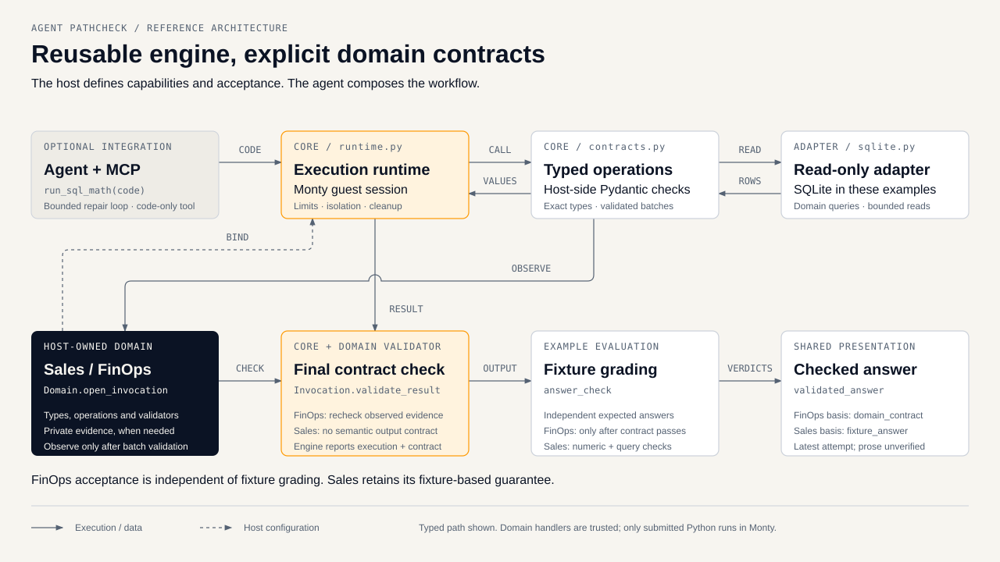

# agent-pathcheck

**Status: reference architecture.** Copy and adapt this pattern; it is not a
maintained library and is not published to PyPI. The Python package is
`agent_pathcheck`.

An agent can return a well-formed answer after reading the wrong period, omitting
evidence, or selecting the wrong records. This repo explores making policy an
executable interface: the host supplies scoped Pydantic types and read operations,
then checks the final answer against what the workflow actually observed.

The agent composes Python inside a fresh bounded Monty session. Host operations
validate complete result batches before recording private evidence. Domain
validators recompute accepted outputs, and presentation keeps checked answers
separate from model prose. Start with the in-memory example, then add SQL and
cross-step rules as needed.



## The pattern

This excerpt from [Level 0](examples/minimal/README.md) shows the boundary. `Read`
and `Number` are strict request/result models; the complete runnable module is
[workflow.py](examples/minimal/workflow.py).

```python
from contextlib import contextmanager
from pydantic import model_validator
from agent_pathcheck import (
    Domain, Invocation, Operation, PolicyModel, PolicyViolation,
    bind_operations, current_evidence, run, validate_model_output,
)
from examples.minimal.workflow import Read, Number

class Total(PolicyModel):
    value: int

    @model_validator(mode="after")
    def check_total(self):
        rows = current_evidence().require(Read())
        if self.value != sum(row.value for row in rows):
            raise PolicyViolation("arithmetic", "total.sum", "Total must match observed numbers")
        return self

@contextmanager
def open_invocation(report):
    query = bind_operations([
        Operation(Read, Number, lambda request: [{"value": 2}, {"value": 4}]),
    ], report["policy_calls"], report["policy_events"])
    yield Invocation({}, {"query": query}, {"Read": Read, "Total": Total},
                     lambda value: validate_model_output(value, Total, report["policy_events"]))

execution = run("rows = query(Read())\nTotal(value=sum(r.value for r in rows))",
                domain=Domain({"unit": "items"}, open_invocation))
assert execution.report["result"] == {"value": 6}
```

Run without a database, API key, or network service:

```bash
python3.12 -m venv .venv
source .venv/bin/activate
python -m pip install -r examples/minimal/requirements.txt
python -m examples.minimal
```

## What is checked

- Rejected batches never become evidence; empty completed batches do. [Test](tests/test_engine_improvements.py)
- Out-of-scope typed requests fail before SQL runs. [Test](examples/sql_math_tracer/test_policy.py)
- FinOps revalidates eligibility, selection, ordering, and arithmetic against observations. [Tests](examples/aws_finops/test_semantics.py)
- Required replay rejects the demonstrated hardcoded totals and selections; abstention needs an exact task-required block. [Tests](tests/test_reference_architecture.py)
- Model prose cannot replace the checked payload. [Test](examples/sql_math_tracer/test_agent.py)

The [claims table](docs/claims.md) maps each guarantee to its named test. It also
records what is **not claimed**: computational derivation, upstream data authenticity,
unencoded business rules, or accurate narrative explanations. Sales uses fixture
answer grading; FinOps adds a semantic domain contract.

## Example levels

| Level | Example | Adds |
| --- | --- | --- |
| 0 | [Minimal](examples/minimal/README.md) | In-memory typed reads and an evidence-checked total |
| 1 | [Sales](examples/sql_math_tracer/README.md) | SQL behind typed scope; policy changes the workflow |
| 2 | [AWS FinOps](examples/aws_finops/README.md) | Cross-step validators, selection, arithmetic; optional replay and abstention |
| 2, optional | [Composable cost claims](docs/composable-claims.md) | Two descriptive questions from scoped, host-recomputed claims and checked text templates |
| Domain walkthrough | [Online store](examples/online_store/README.md) | Ten scenarios from scoped revenue to shared concepts, corrections, composite answers, and a bounded policy planner |

The [core guide](agent_pathcheck/README.md#pattern-vs-extensions) separates the
pattern from optional extensions and integrations.

## Adapt this to your domain

Define scoped requests, strict result rows, host operations, evidence validators,
and an output that recomputes the answer. Wire a `Policy`, `Domain`, and `run()`;
add integrations only when needed. The [six-step guide](docs/adapt.md) includes
code excerpts and a checklist for the important boundaries.

## Verify and read further

```bash
python -m pip install -r examples/sql_math_tracer/requirements.txt
python -m unittest discover -s tests -v
python -m unittest discover -s examples/sql_math_tracer -v
python -m unittest discover -s examples/aws_finops -v
python -m unittest discover -s examples/online_store -v
python -m examples.aws_finops.benchmark --replays
python -m examples.online_store.acceptance --replays
python scripts/check_docs.py
```

[Executable semantic layer](docs/semantic-layer.md) ·
[One-page explanation](docs/policy-as-types-one-pager.md) ·
[Offline benchmark and optional live runs](examples/aws_finops/BENCHMARK.md)

Optional model-connected examples require an explicit `--model MODEL_ID` and a
host-owned `OPENAI_API_KEY`. Choose a model available to your API key that supports
the example's Responses API tool calls and reasoning settings. Offline examples
and CI require neither a model nor credentials. See the individual example guides
for commands. Locally generated results are ignored by Git.
