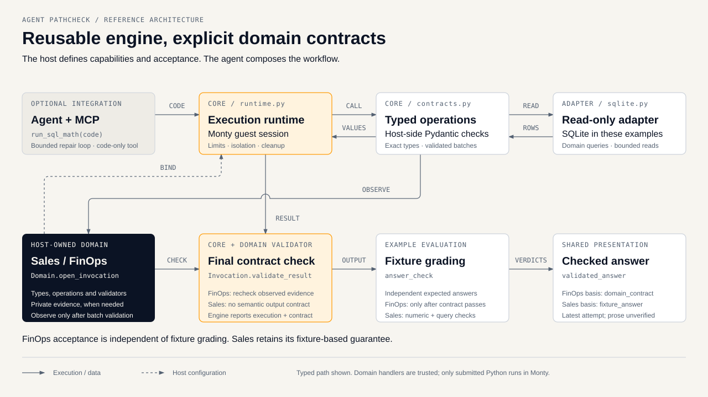
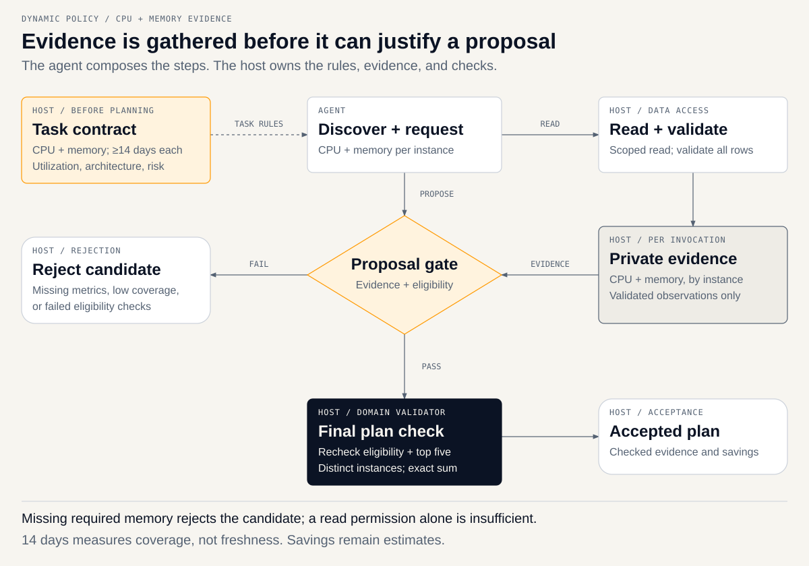

# Policy as types: a reference architecture

An agent can produce a well-formed answer using the wrong month, missing evidence,
or an incorrect selection. This pattern makes task-specific requests and results
executable contracts, then checks the final answer against host-observed data.

The host binds allowed scope into Pydantic request types. The agent composes Python
using those constructors and a read-only query operation. Monty runs that program
in a fresh bounded session. The host validates each whole result batch, records
private evidence, and revalidates the final output before publishing a checked answer.

## Learn it in three steps

| Example | What changes | Evidence of the boundary |
| --- | --- | --- |
| [Level 0: in memory](../examples/minimal/README.md) | Read numbers and return their observed sum. | No read or wrong sum means no checked answer. |
| [Level 1: sales](../examples/sql_math_tracer/README.md) | Typed scope controls SQL; changing totals to rows changes the workflow. | Scope is checked before SQL; arithmetic uses an independent fixture answer. |
| [Level 2: FinOps](../examples/aws_finops/README.md) | CPU/memory evidence controls eligibility, selection, and savings. | Domain validators recompute the answer independently of the fixture grader. |

For the synthetic FinOps base data, requiring memory evidence changes accepted
savings from $500 to $430 per month. The agent must gather the required observations,
select up to five distinct eligible instances, follow the tie-break, and report the
observed total. Empty results are valid only after the required queries complete.

## What belongs in the pattern

Typed scope, atomic batch validation, invocation-local evidence, final revalidation,
and honest result presentation form the essential path. SQL is an adapter. MCP and
model repair loops are integrations. Reusable pools, counterfactual replay, typed
abstention, telemetry, and SQLAlchemy field generation are explicit extensions.

Replay runs the same submitted code against changed data without another model call.
Arithmetic and ranking perturbations catch particular hardcoded answers. An unchanged
trial remains inconclusive; a required trial needs an explicit host exemption to allow
publication. Abstention requires an unresolved block on an exact request the task needs.

## What the checks do not establish

The pattern does not prove arbitrary computational derivation, authenticate upstream
data, enforce rules nobody encoded, or verify explanatory prose. It is a copyable
reference architecture, not a maintained library or a production-ready policy service.

Every current guarantee is linked to a test in [claims](claims.md). Follow
[the adaptation guide](adapt.md) to apply the pattern to another domain, and use
[the benchmark](../examples/aws_finops/BENCHMARK.md) to inspect measured behavior.
